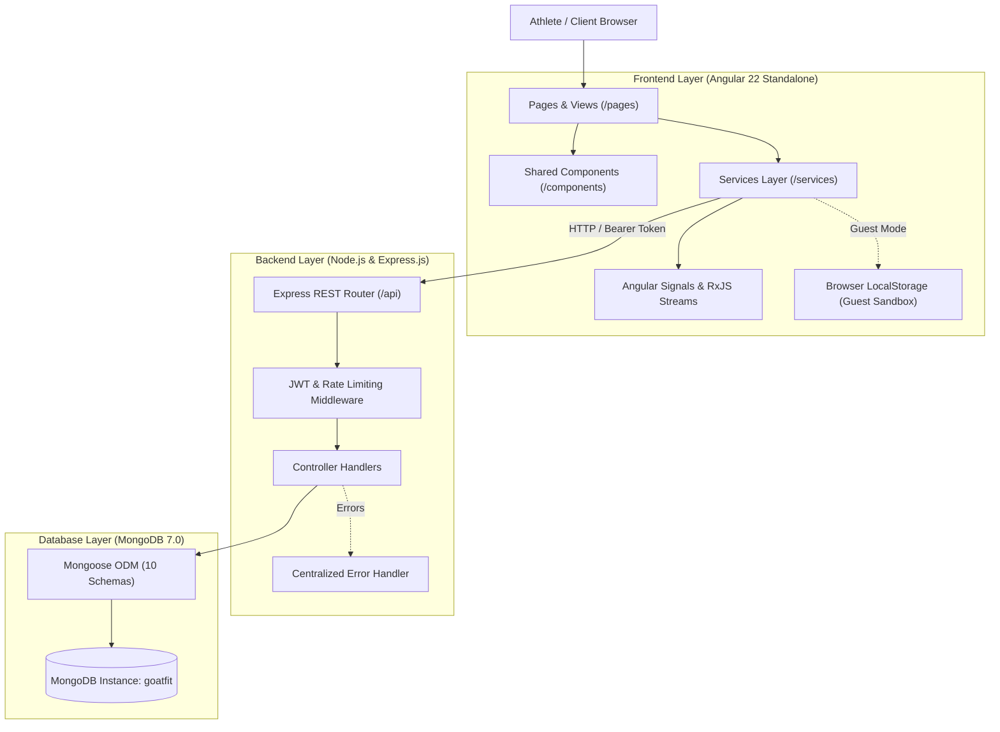

# GOAT FIT — System Architecture & Technical Design Document

## 1. System Overview & Architecture Paradigm

GOAT FIT is architected as an athletic-grade, full-stack Single Page Application (SPA) designed to satisfy the Savitribai Phule Pune University (SPPU) Third Year IT Web Application Development curriculum.



---

## 2. Directory Structure & Monorepo Organization

```
goat-fit-root/
├── client/                     # Angular 22 Frontend Application
│   ├── public/                 # Static assets, Web App Manifest, Service Worker
│   │   ├── assets/images/      # Extracted presentation images (hero, exercises, athletes)
│   │   ├── manifest.webmanifest# PWA metadata & theme tokens
│   │   └── service-worker.js   # Offline caching & app shell strategy
│   ├── src/
│   │   ├── app/
│   │   │   ├── components/     # Reusable layout UI (header, footer, rest-timer)
│   │   │   ├── models/         # TypeScript data contracts (workout, session, planner, etc.)
│   │   │   ├── pages/          # Routed views (home, workouts, exercises, planner, hydration, etc.)
│   │   │   ├── services/       # Injectable API, auth, timer, and state services
│   │   │   ├── guards/         # Angular route guards (authGuard)
│   │   │   ├── app.routes.ts   # Client routing table
│   │   │   └── app.config.ts   # Angular platform providers & interceptors
│   │   ├── styles.css          # Design system CSS variables & athletic typography
│   │   └── index.html          # HTML5 entry with Bebas Neue, Inter, and Outfit fonts
│   ├── Dockerfile              # Multi-stage production container build
│   └── nginx.conf              # Nginx reverse proxy configuration
│
├── server/                     # Node.js & Express.js REST API
│   ├── src/
│   │   ├── config/             # Database connection & environment configuration
│   │   ├── middleware/         # Auth, rate limiting, and centralized error handling
│   │   ├── models/             # Mongoose 8 schemas (User, WorkoutProgram, Exercise, etc.)
│   │   ├── routes/             # Express API routes mounted under /api
│   │   ├── seed/               # Starter database seeder (programs, exercises, athletes)
│   │   ├── tests/              # Automated verification test suite (19 test cases)
│   │   └── server.js           # Server bootstrap and graceful shutdown
│   ├── Dockerfile              # Node.js container build
│   └── .env.example            # Environment variables placeholder
│
├── docs/                       # Technical & Academic Documentation
│   ├── CURRICULUM_MAPPING.md   # SPPU WAD Course Outcomes (CO1 to CO5) mapping
│   ├── ARCHITECTURE.md         # System architecture and technical design
│   └── API.md                  # RESTful API endpoint specifications
│
├── postman/                    # Postman collection & environment for API testing
├── docker-compose.yml          # Multi-container local deployment orchestration
├── package.json                # Monorepo development scripts
└── README.md                   # Master project documentation
```

---

## 3. Data Flow & Synchronization Strategy

### A. Authenticated Mode (MongoDB Backed)
1. The user logs in via `POST /api/auth/login` and receives a signed JWT with a 7-day expiration.
2. The Angular `authInterceptor` automatically attaches the token as `Authorization: Bearer <token>` to all subsequent HTTP requests.
3. Express middleware (`protect`) validates the JWT, decodes the athlete ID, and fetches the user object.
4. Data mutations (completing workout days, logging water glasses, updating macro profiles, recording workout volume) are persisted directly to MongoDB collections with indexing and user isolation.

### B. Isolated Guest Demo Mode (Client Sandbox)
1. Visitors can click **Enter Guest Demo Mode** without creating an account.
2. The frontend activates the guest state via `AuthService.isGuest = true` and stores the flag in browser `localStorage`.
3. All service methods (`PlannerService`, `HydrationService`, `NutritionService`, `SessionService`) dynamically branch:
   - Authenticated: Perform HTTP call to Express backend.
   - Guest: Read/write to isolated `localStorage` keys (`goatfit_guest_weekly_plan`, `goatfit_guest_hydration`, `goatfit_guest_nutrition`, `goatfit_guest_sessions`).
4. This guarantees that visitors can test every interactive workflow without creating garbage records on the production MongoDB instance or exposing one user's data to another.

---

## 4. Key Engineering Implementations

### 1. Reliable Rest Timer Math
Standard `setInterval` countdown implementations fail when users switch browser tabs because modern operating systems aggressively throttle inactive JavaScript threads. GOAT FIT resolves this in `TimerService` using timestamp deltas:
$$\text{Remaining Seconds} = \max\left(0, \text{round}\left(\frac{\text{Target Deadline Timestamp} - \text{Current Timestamp}}{1000}\right)\right)$$
This guarantees that regardless of how long the tab is in the background, the timer reflects the precise real-world seconds remaining upon refocus.

### 2. Clinical Mifflin-St Jeor TDEE Engine
Total Daily Energy Expenditure is computed through validated scientific formulas:
- **Men:** $\text{BMR} = 10 \times \text{weight (kg)} + 6.25 \times \text{height (cm)} - 5 \times \text{age (yrs)} + 5$
- **Women:** $\text{BMR} = 10 \times \text{weight (kg)} + 6.25 \times \text{height (cm)} - 5 \times \text{age (yrs)} - 161$
- **TDEE:** $\text{BMR} \times \text{Activity Multiplier}$ ($\text{Sedentary}=1.2, \text{Light}=1.375, \text{Moderate}=1.55, \text{Heavy}=1.725, \text{Athlete}=1.9$)
- **Macronutrient Grams:**
  - $\text{Protein (g)} = \frac{\text{Target Calories} \times 0.35}{4}$
  - $\text{Carbohydrates (g)} = \frac{\text{Target Calories} \times 0.45}{4}$
  - $\text{Fats (g)} = \frac{\text{Target Calories} \times 0.20}{9}$

### 3. Tonnage Volume Engine
During live workout logging (`ActiveWorkoutComponent`), volume is computed on every set:
$$\text{Total Session Volume (kg)} = \sum_{\text{exercises}} \sum_{\text{sets}} \left(\text{Weight in kg} \times \text{Reps}\right)$$
This metric is recorded and charted on the Athlete Dashboard to monitor progressive overload over time.
